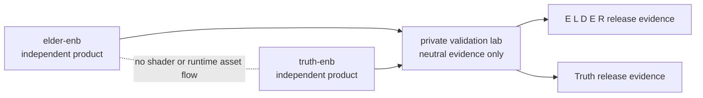

# E L D E R ENB and Truth ENB — Product Architecture and Recovery Design

**Date:** 2026-07-14

**Status:** Approved product design; implementation has not started

**Repository codenames:** `elder-enb`, `truth-enb`

## 1. Purpose

This specification defines the recovery, separation, modernization, and release architecture for two full-scale Skyrim Special Edition ENB projects:

- **E L D E R ENB** remains an ENB workshop: a mature visual foundation whose defining strength is user creativity through profiles, layered preset overlays, and optional integration packs.
- **Truth ENB** becomes a tightly authored thematic product: a first-party shader suite with a deliberate master look, restrained quality variants, and no dependency on E L D E R's third-party shader stack.

The products may reuse neutral engineering methods, but they must not share rendering assets or shader implementations. This prevents Truth from becoming an E L D E R fork and preserves each product's identity, provenance, tuning model, and release cadence.

## 2. Fixed decisions and scope

The following decisions are binding for implementation:

1. E L D E R and Truth are separate product repositories and separate Nexus releases.
2. They do not share HLSL/FX source, headers, LUTs, textures, tuned parameters, weather manifests, or runtime assets.
3. A private, non-shipping validation lab may serve both repositories. It may contain only neutral tooling: parsers, schema validation, compilation orchestration, include-closure checks, deterministic packaging, provenance checks, screenshot comparison, and performance analysis.
4. E L D E R retains its established ENB, Silent Horizons 2, ENB Extender, KiLoader, and KreatE architecture.
5. Truth replaces those shader-layer requirements with original first-party concepts and shaders. Its external runtime foundation is ENBSeries, SKSE, Address Library, the Visual C++ runtime required by the final build, and an ENB-compatible SkyrimBridge integration derived from the preserved 1.2 lineage.
6. RAW is excluded. It replaces ENB and Community Shaders and therefore belongs to a separate project with different DNA.
7. Community Shaders is a competitive and technical benchmark, not a Truth dependency or source-sharing route. It remains an incompatible renderer alternative when ENB is active.
8. Reverse engineering or decompilation of LonelyKitsuune tooling is permitted for diagnosis and behavioral specification. Decompiled code and third-party binaries must remain quarantined and may never enter either shipping tree or release archive.
9. The historical removed Nexus project named **The Truth ENB** creates a branding collision. `truth-enb` remains the repository codename; final public naming or a subtitle is a separate release decision and does not change this architecture.

## 3. Verified recovery baseline

### 3.1 E L D E R ENB

The current source is at `C:\Users\Zain\ENB`, with clean release baselines preserved on the Desktop:

- `Elder ENB - Universal (FINAL).7z` — 1,811 files
- `Required Files (FINAL).7z` — 49,405 files
- `Neutral KreatE Preset.7z` — 1,334 files

The public Nexus release was last updated on 2026-02-20. Its dependency stack subsequently changed:

| Component | Target version | Relevant state |
|---|---:|---|
| Silent Horizons 2 Shader Core | 1.10 | Core release remains the established E L D E R shader basis |
| ENB Extender | 1.4.3 | 2026-02-25 update includes a rare startup technique-binding fix |
| KiLoader | 1.2 | Required loader layer for the established stack |
| KreatE | 1.5 | 2026-02-25 update introduced FormID-to-form-symbol conversion, bulk weather operations, and backups |

The recovered dependency binaries are pinned as forensic inputs rather than trusted by file name alone:

- ENB Extender 1.4.3 `KiENBExtender.dll`: SHA-256 `CEF8767D1FBC544AEEEE538FFBE1F5F1F0944A808AB81D3A41667DC97FAA84A3`
- ENB Helper SE 1.4.3: SHA-256 `B9B0348F74E4506EF8A7D43033E771FBBFD3A336F8008AFCDFB525BA0278EFEA`
- KreatE 1.5 `KreatE.dll`: SHA-256 `24129130C02B5B1709FAB77C54CAEADA971551FCE530456F701637D10F834413`

The deployed E L D E R experiment still contains ENB Extender/Helper 1.4.2 binaries with different hashes. Baseline testing must therefore distinguish the current deployed state from the pinned 1.4.3 repair target.

The recovered state establishes the following defects and risks:

- The 37 KreatE presets are predominantly old `ConfigVersion` 1.3.0/1.3.2 packages containing 1,334 files each.
- A 2026-03-02 conversion attempt upgraded Blockbuster from 1.3.2 to 2.0.0, removed or moved 829 unloadable optional records, and completed with 0 errors but 829 warnings. Form-symbol conversion was load-order-specific, and 197 malformed lines were found.
- The current overlay source contains 193 files representing 175 canonical identities, with 18 duplicate identities.
- The latest static parser found 3,373 overlay parameters: 3,043 additive `+` operations and 330 absolute `=` operations.
- Of those parameters, 562 target `enbseries.ini`; 2,811 refer to runtime shader UI controls where the overlay schema does not carry a file name. Those controls must be resolved against the exact runtime registry and must not be declared dead from static absence alone.
- Twelve static references to `FIRE.IntensityInterior` remain unresolved.
- The prior conversion script inferred baselines from name substrings. That heuristic is unsafe for additive overlays because a wrong baseline changes both application and removal behavior.
- Four prepass add-ons are included unconditionally by shipping shader source but absent from the public main archive:
  - `Addons/PrePass_StylizationSuite.fxh`
  - `Addons/PrePass_ParticleField.fxh`
  - `Addons/PrePass_PhotoStudio.fxh`
  - `Addons/PrePass_SnowCover.fxh`

The reported failures align with the newer Silent Horizons 2 / ENB Extender overlay path and KreatE conversion workflow. AELAS/EVLaS configuration files are inert in this context and are not treated as the root cause.

### 3.2 Truth ENB

The recovered seed is at `E:\Modlists\SkyGroundChronicles\mods\Truth ENB\ROOT`. It contains 1,946 files and no independent repository history or product documentation.

The seed is useful as behavioral archaeology, but not as a shipping foundation:

- All five profiles have shader compilation failures in at least some permutations.
- Across 72 active shader/include files, 35 include edges resolve without missing include files, but only 34 files are reachable from active entry points; 38 are orphaned.
- Active SkyrimBridge constant-buffer use is concentrated in prepass code while richer older modules remain orphaned.
- `EnableMultipleWeathers=false` and `EnableLocationWeather=false`, so the package does not currently deliver authored weather/location behavior.
- Weather LUTs are identical placeholders, and the texture corpus collapses to roughly ten unique hash groups.
- The package shares 1,941 file paths with a deployed E L D E R experiment; 1,919 of those files are byte-identical. This is recovery-lineage contamination, not an acceptable future sharing model.
- Truth-specific recovery artifacts include `Helper/SB_TemporalCore.fxh`, `SB_DenoiseCore.fxh`, `SB_LensCore.fxh`, `SkyrimBridge_ENB.dllplugin`, and a diagnostic log.
- Known compile defects include duplicate functions or tokens, undefined `DELTA` and underwater/depth symbols, missing vertex-shader entry points, dimensional type mismatches, and an uninitialized `float2 sampleUV.y` in `enblens`.
- Third-party and no-derivatives provenance within the recovered corpus requires a clean first-party rendering rebuild.

### 3.3 SkyrimBridge lineage

`C:\dev\protected\reverse-engineering\SKSE\Playground` is mixed with current RAW-oriented work, and its build configuration explicitly drops ENB support. It is not a Truth source basis.

`C:\dev\protected\reverse-engineering\SKSE\PlaygroundOldSources\SkyrimBridge1.2.0` preserves the correct ENB-compatible lineage: CommonLibSSE-NG/SKSE integration, `ENBSetParameter`, the `SkyrimBridge.fxh` interface, and first-frame binding diagnostics. Historical pipeline notes show that missing SkyrimBridge declarations once caused every `SetParameter` call to fail silently; the repaired lineage added the header and logged return status. Truth must preserve and extend that observability.

The archived `HarperZ9/skyrim-bridge` repository is marked as superseded by RAW. Truth will therefore own a clean, product-local ENB integration derived from the preserved 1.2 lineage rather than reviving SkyrimBridge as a shared standalone product.

## 4. Product and repository architecture

The destination workspace contains three independent repositories or roots at fixed locations:

```text
C:\dev
├── elder-enb                 # Shipping product repository
├── truth-enb                 # Shipping product repository
└── tools\enb-validation-lab # Private, neutral, non-shipping tooling
```

The product repositories are normal owned `C:\dev` repositories. Quarantined reverse-engineering material remains under `C:\dev\protected` and is referenced only through evidence manifests. The validation lab is never packaged by either product.



Allowed neutral outputs include machine-readable diagnostics, hashes, compile reports, performance samples, image-difference metrics, and package manifests. The lab may compare both products, but it may not become a third runtime dependency or a covert shared shader library.

## 5. E L D E R ENB design

### 5.1 Product intent

E L D E R remains the comprehensive workshop. Its value is breadth, composability, and safe creative control rather than convergence on one canonical look. Existing visual identity and shader investment should be preserved while the configuration, navigation, dependency contract, and release process become dependable.

### 5.2 Typed overlay model

The 175 canonical overlays will be represented by a declarative source model containing:

- stable identity, display name, group, order, and compatibility metadata;
- exact target registry identifier and value type;
- operation semantics (`absolute`, `additive`, or another explicitly supported runtime operation);
- permitted range, default/baseline, and removal semantics;
- required runtime component and minimum version;
- incompatibilities, prerequisites, and intended stack behavior.

Generated overlay files are build artifacts. The generator must resolve every runtime control against an extracted registry from the exact ENB Extender 1.4.3 / Silent Horizons 2 1.10 combination. No substring-based baseline inference is allowed. Duplicate source identities, unknown targets, ambiguous types, invalid ranges, or non-reversible additive operations are build failures.

Validation must exercise individual application/removal and representative stacked sequences in both directions. Ordering is semantic: changing overlay order requires a reviewed source change and regenerated evidence.

### 5.3 KreatE modernization

Each of the 37 profiles will be converted deliberately to the KreatE 1.5 form-symbol model. The process must:

1. start from a clean known load order and record its plugin fingerprint;
2. preserve a lossless original archive outside the generated tree;
3. classify malformed and unloadable records rather than silently discarding them;
4. translate optional integrations into named packs instead of making the portable core dependent on one modlist;
5. verify weather, interior, image-space, cell, and location assignments through a clean runtime load;
6. produce a conversion report for every profile, including intentional omissions and their reason.

The portable core targets vanilla Skyrim and official DLC records. Load-order-specific support belongs in explicit optional packs with a declared dependency and fingerprint.

### 5.4 Shader and package hardening

E L D E R work includes:

- restoring the four missing prepass includes and validating recursive include closure for every profile and quality tier;
- compiling all relevant entry points and macro permutations with warnings classified;
- retaining Silent Horizons 2 as the established shader foundation while polishing safe defaults, UI grouping, performance tiers, and rollback behavior;
- shipping exact dependency/version manifests and distinguishing required, optional, and incompatible components;
- deterministic archives, clean-root install simulations, archive-to-manifest diffs, and provenance/license gates;
- user-facing diagnostics that identify missing requirements, unresolved controls, invalid profile state, or shader compilation failure without silent degradation.

## 6. Truth ENB design

### 6.1 Product intent

Truth is a clean authored synthesis, not a broad workshop and not a copy of E L D E R. It should feel like a singular release by a top-tier ENB author: coherent across weather, interiors, characters, materials, night, underwater, and difficult lighting transitions. It ships a primary master look with restrained performance/quality modes; it does not expose an E L D E R-sized surface of interchangeable style overlays.

### 6.2 Clean first-party renderer

Every shipping rendering implementation is newly authored for Truth. The recovery package supplies test cases, visual intent clues, failure reproductions, and compatibility observations only. No third-party shader source, LUT, texture, parameter block, or decompiled implementation may cross into the clean shipping tree.

Truth's planned shader systems are:

- luminance measurement, exposure, and temporally stable adaptation;
- tone mapping, gamut handling, perceptual grading, and authored weather/location response;
- bloom, halation, lens response, flare, and celestial treatment;
- ambient occlusion, indirect response, reflections, contact shadows, skin response, and atmospheric integration;
- temporal denoising and history rejection driven by SkyrimBridge scene and camera data;
- depth of field, underwater, night-eye, rain, film response, grain, dithering, sharpening, and final composition;
- distinct authored LUTs and real weather/interior/location behavior rather than duplicated placeholders.

Each system must have an explicit input contract, numeric range, color space, temporal-history policy where relevant, failure fallback, and GPU budget. Shader code must include finite-value/NaN guards at unstable boundaries and compile cleanly across supported permutations.

### 6.3 SkyrimBridge integration

Truth owns an ENB-compatible native plugin based on the preserved SkyrimBridge 1.2 behavior and interface. Its responsibilities are deliberately narrow:

- collect supported game, weather, location, camera, and scene state;
- publish versioned, documented parameters to ENB;
- validate binding on the first usable frame and after relevant lifecycle transitions;
- log each required binding's availability and return status;
- expose a compact health state for user diagnostics;
- degrade safely when optional data is unavailable, without undefined shader values.

The bridge does not replace ENB, hook a competing renderer, import RAW architecture, or become a generic shared service. Any new ABI is versioned within Truth and tested against the supported Skyrim runtime matrix.

### 6.4 Quality posture

Truth's release gate is experiential as well as technical. A fixed capture corpus will cover exterior day/night, rapid exposure transitions, interiors, skin, foliage, water, snow, fog, rain, underwater, combat effects, and representative weather/location transitions. Every candidate is evaluated for:

- temporal stability, ghosting, shimmer, disocclusion, and history rejection;
- highlight retention, black-floor behavior, banding, gamut excursion, and adaptation comfort;
- material legibility and consistent art direction;
- GPU time by pass, memory cost, and quality-mode scaling;
- deterministic compilation, installation, and rollback.

Community Shaders 1.7.3 and relevant contemporary ENB/ReShade releases are benchmark references for capability, stability, and user expectations. Truth must differentiate through integration, authored coherence, temporal quality, diagnostics, and predictable performance—not by importing their code.

## 7. Diagnostic and clean-room policy

Research material is divided from shipping material by repository, directory, and provenance manifest.

```text
Quarantined research input
    -> behavior notes and black-box test cases
    -> independently written specification
    -> clean first-party implementation
    -> provenance review
    -> shipping tree
```

Permitted research outputs are observed inputs/outputs, call sequences, schemas, failure signatures, registry identifiers, timing data, and compatibility notes. Prohibited outputs include copied/decompiled implementation, reconstructed proprietary assets, third-party binaries in release archives, or source whose provenance cannot be explained. Hash-based gates will reject known research binaries and third-party shader artifacts from shipping packages.

## 8. Error handling and observability

Both products must make failures actionable:

- **Build time:** fail on missing includes, duplicate canonical IDs, unknown overlay controls, invalid types/ranges, unresolved shader entry points, provenance violations, nondeterministic package contents, or unexpected archive drift.
- **Install time:** identify absent or wrong-version hard requirements and distinguish optional integrations.
- **Runtime:** surface shader compile failures, bridge binding failures, registry mismatch, unavailable optional data, and active fallback mode. Silent failure is unacceptable for required features.
- **Release evidence:** retain machine-readable manifests, hashes, compiler output, overlay/KreatE validation reports, screenshot-difference results, GPU captures, clean-install results, and known limitations for the exact release commit.

Diagnostics must avoid absolute developer paths, secrets, personal data, and noisy per-frame logging in normal operation.

## 9. Test and release gates

### Shared neutral gates

- recursive include closure and entry-point discovery;
- compile matrix with zero unexplained failures;
- deterministic package manifest and reproducible archive hash where tooling permits;
- clean-root install/uninstall/rollback simulation;
- prohibited-file, provenance, and license scan;
- screenshot corpus comparison with reviewed intentional deltas;
- performance capture on declared quality modes;
- versioned dependency and compatibility manifest.

### E L D E R-specific gates

- 175 unique canonical overlay identities with no unintended duplicates;
- every overlay target resolves against the pinned runtime registry;
- apply/remove and stack-order tests pass for representative combinations and every high-risk additive control;
- all 37 KreatE profiles load on their declared core/integration environment with intentional omissions documented;
- no missing required prepass includes or silent profile degradation;
- public archive matches the release manifest and installation guide.

### Truth-specific gates

- no shipping third-party renderer source or asset contamination;
- all supported Skyrim runtime/native-plugin combinations bind or fail with an explicit diagnostic;
- no undefined, non-finite, or uninitialized path in supported shader permutations;
- temporal stability and performance budgets pass the fixed capture corpus;
- master look remains coherent across the declared weather/interior/location matrix;
- Community Shaders and contemporary ENB/ReShade comparisons are recorded as benchmark evidence, not treated as compatibility promises.

## 10. Migration and implementation sequence

Implementation proceeds in dependency order:

1. Freeze and hash the current E L D E R working tree, clean release archives, Truth recovery seed, exact dependency binaries, and quarantined research inputs without modifying originals.
2. Create the independent C:\dev product repositories and private validation lab; add provenance and package-boundary enforcement first.
3. Establish reproducible baseline builds, archive manifests, compile reports, and clean-install tests for recovered states.
4. Repair E L D E R include closure, build the exact runtime control registry, replace heuristic overlay generation with the typed model, and convert/validate the 37 KreatE profiles.
5. Polish E L D E R navigation, defaults, quality tiers, optional packs, documentation, diagnostics, and release packaging without replacing its shader identity.
6. Reduce Truth recovery material to behavioral specifications and regression cases; establish the clean-room boundary.
7. Build and validate Truth's product-owned SkyrimBridge integration, then author shader systems incrementally against visual and performance budgets.
8. Tune Truth's master look across the fixed capture corpus, add restrained quality modes, and complete installation, troubleshooting, and compatibility documentation.
9. Run independent release-candidate audits for both products and prepare Nexus packages, changelogs, evidence, and rollback archives. Publishing remains a separate explicit action.

Work may proceed in parallel only after repository boundaries, provenance gates, and baseline evidence exist. Changes to one product cannot be copied into the other as a shortcut.

## 11. Frontier position

The July 2026 competitive baseline includes Picta Realis, Dawnfire, Everwild, Fimbul, True Light II, and Community Shaders 1.7.3. Their relevant signals are integrated weather breadth, authored Silent Horizons/NAT looks, stability-driven simplification, ENB/ReShade hybridization, consolidated alternatives, and increasingly broad real-time renderer modules.

E L D E R should win on workshop depth, reliable layered creativity, dependency clarity, reversibility, and package quality. Truth should win on original shader maturity, singular art direction, temporal stability, runtime observability, integration, and performance predictability. Compatibility is preferred where it preserves those identities; replacement is preferred when a third-party requirement prevents Truth from owning its rendering concept.

## 12. References

- [E L D E R ENB](https://www.nexusmods.com/skyrimspecialedition/mods/117327)
- [ENB Extender](https://www.nexusmods.com/skyrimspecialedition/mods/99406)
- [KiLoader](https://www.nexusmods.com/skyrimspecialedition/mods/99404)
- [KreatE](https://www.nexusmods.com/skyrimspecialedition/mods/83757)
- [Silent Horizons 2 Shader Core](https://www.nexusmods.com/skyrimspecialedition/mods/101696)
- [Silent Horizons 2 Universal Core](https://www.nexusmods.com/skyrimspecialedition/mods/99398)
- [Kitsuune February 2026 development notes](https://kitsuune.pages.dev/blog/updates/february-2026/)
- [Community Shaders](https://www.nexusmods.com/skyrimspecialedition/mods/86492) and [v1.7.3 release](https://github.com/community-shaders/skyrim-community-shaders/releases/tag/v1.7.3)
- [Picta Realis](https://www.nexusmods.com/skyrimspecialedition/mods/178136)
- [Dawnfire](https://www.nexusmods.com/skyrimspecialedition/mods/175076)
- [Everwild](https://www.nexusmods.com/skyrimspecialedition/mods/182868)
- [Fimbul](https://www.nexusmods.com/skyrimspecialedition/mods/173199)
- [True Light II](https://www.nexusmods.com/skyrimspecialedition/mods/181432)
- [Historical removed The Truth ENB listing](https://www.nexusmods.com/skyrimspecialedition/mods/9162)
