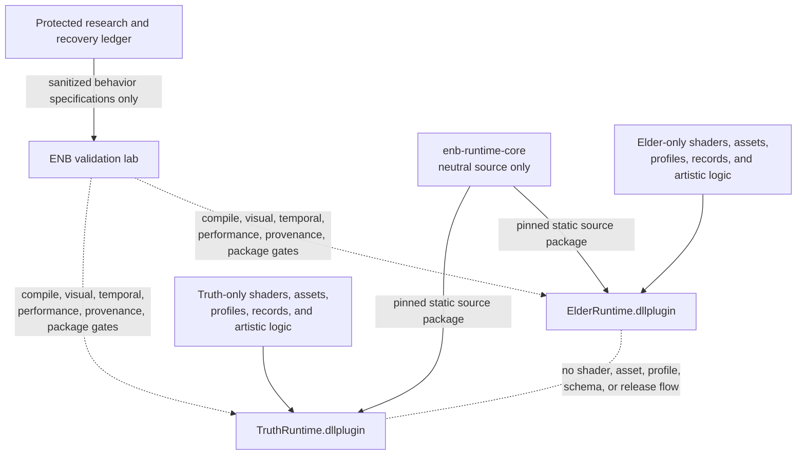

# E L D E R ENB and Truth ENB — Product Architecture, Recovery, and Replacement Design

**Date:** 2026-07-14

**Status:** Approved architecture; authoritative preplanning preservation complete; implementation has not started

**Product repositories:** `elder-enb`, `truth-enb`

**Neutral source repository:** `enb-runtime-core`

**Private validation repository:** `tools/enb-validation-lab`

## 1. Executive decision

E L D E R ENB and Truth ENB will become two complete, independently versioned Skyrim Special Edition ENB products with one unavoidable external rendering runtime: ENBSeries.

They will share a neutral, product-owned native-engine foundation as source code. That foundation will be statically compiled into two different product binaries:

- `ElderRuntime.dllplugin`
- `TruthRuntime.dllplugin`

There will be no installed shared runtime DLL. The products will not share shaders, HLSL/FX headers, meshes, textures, LUTs, weather data, control schemas, profiles, tuned parameters, artistic state machines, or release payloads.

The products have different purposes:

- **E L D E R ENB** is the workshop: broad, composable, profile-driven, reversible, and designed for user creativity.
- **Truth ENB** is the authored statement: a singular master look with restrained quality modes and a much smaller profile surface.

The current third-party requirement stack is a research and compatibility reference, not the future public runtime architecture. KiLoader, ENB Extender/Helper, KreatE, Worldspace Weatherlists, Silent Horizons 2, and Helios-class supporting tools will be replaced by product-owned implementations before the new releases are considered complete.

RAW remains outside this project. It replaces ENB and Community Shaders and retains separate architecture and product DNA.

## 2. Binding scope and invariants

The following decisions are fixed:

1. Elder and Truth are separate repositories, separate binaries, separate asset namespaces, separate Nexus releases, and separate release cadences.
2. The only reusable shipping source is neutral native-engine infrastructure in `enb-runtime-core`.
3. `enb-runtime-core` contains no shader source, shader include, profile, LUT, mesh, texture, weather tuning, artistic parameter, product control schema, or product identifier.
4. Each product consumes an exact hash-pinned source release of the neutral core and embeds it in its own binary. No shared DLL is installed.
5. Apart from Skyrim itself, ENBSeries is the only required external runtime. The product archives will not require SKSE, Address Library, CommonLibSSE-NG, ENB Helper, KiLoader, ENB Extender, KreatE, SH2, Helios, MMSF, Luma, or XEMI.
6. Native product binaries use the static Microsoft C/C++ runtime. Their PE import tables are restricted to a reviewed Windows-system allowlist; ENB exports are resolved dynamically and validated against SDK 1002, and game addresses are accessed only through fingerprint-gated relocation packs. Skyrim is not treated as an import-library surface. A separate Visual C++ redistributable is not an end-user requirement.
7. Development and validation may use SKSE/CommonLib as an oracle. Those components never enter a public package or end-user dependency list.
8. Reverse engineering and decompilation across the full ENB, Community Shaders, and Skyrim modding-community corpus relevant to the planned capabilities are authorized for this project. Research inputs remain private and quarantined. Only behavioral specifications, interfaces, test vectors, and independently authored implementations may enter clean repositories.
9. ENBSeries binaries will not be redistributed. Users obtain the supported ENBSeries build from its author; release documentation identifies the supported version and fingerprint.
10. Existing Elder and recovered Truth sources are preserved before migration. A verified preplanning custody snapshot is completed before the first new repository commit, and a final source lock is completed after planning commits but before clean repositories are initialized. Originals are copied, never moved or deleted, during preservation.
11. The active `H:\SteamLibrary\steamapps\common\Skyrim Special Edition` root is RAW/APEX-oriented. Its `d3d11.dll` is the APEX proxy, not an ENB wrapper, and will not be overwritten. ENB runtime testing uses a separate isolated instance.
12. AELAS/EVLaS configuration files are inert with respect to the reported preset-overlay failure and are not treated as its root cause.
13. Silent failure is a release-blocking defect for required functionality.

## 3. Verified recovery baseline

The facts in this section were observed on 2026-07-14 (America/Los_Angeles). Before this specification is committed, the external custody ledger freezes the commands, source roots, timestamps, manifests, and outputs under:

`C:\dev\protected\migration-ledger\enb-recovery-2026-07-14\custody-0003\reports`

Attempts `custody-0001` and `custody-0002` failed closed and remain preserved as non-authoritative evidence. The copied verifier validates `custody-0003\COMPLETE.json` with all 41 required gates, and the external completion anchor is `outputs\custody-0003-completion-anchor.json` in the planning workspace, SHA-256 `A2B1F942E4696A15CB902DAB44B81E7025E21D0ADD85FE85FA269F8DA3B33D8C`.

The required evidence index is `reports\evidence-index.json`; its entries include the producing command, tool version, source path, start/end time, exit code, output hash, and links to the following reports:

- `elder-tree-inventory.json`
- `elder-git-inventory.json`
- `elder-overlay-audit.json`
- `elder-profile-audit.json`
- `truth-tree-inventory.json`
- `truth-shader-matrix.json`
- `enb-0.504-evidence.json`
- `frontier-2026-07-14.md`
- `command-log.ndjson`

If a count in this document differs from a regenerated report, the report and its source lock govern and the discrepancy blocks migration.

### 3.1 E L D E R ENB

The preplanning source anchor is `C:\Users\Zain\ENB` on branch `docs/elder-truth-design` at commit `889e1a7f70a3d565955ed500134c80af19342eb0`, plus the separately inventoried working-tree state. Later documentation commits do not replace this custody anchor.

The live checkout contains five real Git repositories, no `.gitmodules`, and user-owned dirty work in every repository. A normal clone of the top repository cannot preserve the complete physical tree.

The current content-only inventory is:

- 96,034 files
- 831,416,426 bytes
- one reserved zero-byte path, `nul`
- maximum content path length of 235 characters

The overlay corpus contains:

- 193 overlay INI files
- 175 unique `UIName` identities
- 18 duplicated identities
- 3,373 parameter operations
- 3,043 additive operations
- 330 absolute operations
- 562 explicit `enbseries.ini` targets
- 2,811 shader-control operations whose source format does not identify a file
- 12 statically unresolved references to `FIRE.IntensityInterior`

The 37 current KreatE profile directories contain:

- 33 profiles with `ConfigVersion = 1.3.0`
- 4 profiles with `ConfigVersion = 1.3.2`
- 1,334 files per profile in the recovered layout

The previous Blockbuster conversion experiment reached `2.0.0`, classified 829 unloadable optional records, produced 829 warnings and no reported conversion errors, and found 197 malformed lines. This is evidence that the old data can be translated, not proof that the resulting profile is portable or correct.

The public support history confirms the actual user-facing failure: selecting a visual overlay could do nothing unless the user separately located and loaded the matching KreatE preset. Some matching preset states also produced broken or black nights. The defect is a split, non-transactional state model rather than an AELAS/EVLaS load issue.

Four prepass includes referenced unconditionally by the recovered public shader tree are absent from that public archive:

- `Addons/PrePass_StylizationSuite.fxh`
- `Addons/PrePass_ParticleField.fxh`
- `Addons/PrePass_PhotoStudio.fxh`
- `Addons/PrePass_SnowCover.fxh`

These are retained as legacy-baseline defects. The replacement renderer will not inherit the broken include contract.

### 3.2 Distinct Elder release archives

Six same-named but non-identical release artifacts have been found and must be preserved under unique identifiers:

| Artifact | Files | SHA-256 |
|---|---:|---|
| Desktop Elder Universal | 1,811 | `D54A48A708F6A5BD5D34CD3CF48EDEDAA5817521EB4D09F4CC25754127CF79AA` |
| Desktop Required Files | 49,405 | `65DEB029A35C792C77559DE7666B1C65152D1A31E30024702463083D9CBBE902` |
| Desktop Neutral KreatE | 1,334 | `51141D1FF15599EB0ED0047A4ABDDE67C352925321EEECA67A1E71E7CB28386A` |
| Downloads Elder Universal | 1,810 | `6D536AC27B22FD7008105C1D2D5F7ABDDA13B372D11A0EA87412E135281BEF97` |
| Downloads Required Files | 7,347 | `EEFF737A7BE51349FF128A7A14BA322081505DC8E9211543E19A51FE7F6874B6` |
| Downloads Neutral KreatE | 1,334 | `7CBF4D22FBCC280A45DAEF1DC5047C4D530260B0FC2E38EF0BB9A58C6C362DC9` |

All six pass `7z t` and are independent preservation inputs.

### 3.3 Truth ENB

The recovered seed is `E:\Modlists\SkyGroundChronicles\mods\Truth ENB\ROOT`.

Its verified identity is:

- 1,946 files
- 91,724,732 bytes
- legacy recovery digest `C47ED4D6FC6B3DB988399D545C8AB1D386068FC3A16C514A796FEE93DA9AC49D`; the originating command and digest construction were not retained, so this value is orientation evidence superseded by custody-0003's reproducible tree digest
- no independent Git history

The seed is behavioral archaeology, not a shipping foundation:

- 72 shader/include files contain 35 resolved include edges.
- Only 34 files are reachable from active entry points; 38 are orphaned.
- A prior exploratory audit reported 54 effect/profile compile cases: 39 pass and 15 fail, with 104 warnings and 30 errors. Its exact command and toolchain were not retained, so a fresh hash-pinned matrix is required before these figures support a release claim.
- That exploratory audit attributed one `enblens.fx` failure to an incompletely initialized `sampleUV`.
- It also reported at least one failed permutation in each of the five profiles.
- Weather and location behavior are disabled.
- Recovered weather LUTs are duplicated placeholders.
- The texture corpus collapses to roughly ten unique hash groups.
- 1,941 paths overlap a deployed Elder experiment and 1,919 of those files are byte-identical.

No recovered Truth shader, DLL, LUT, texture, mesh, or configuration file crosses into the clean Truth repository by default.

### 3.4 SkyrimBridge lineage

The useful ENB-compatible predecessor is:

`C:\dev\protected\reverse-engineering\SKSE\PlaygroundOldSources\SkyrimBridge1.2.0`

The newer RAW Playground has intentionally dropped ENB support and is not the source basis for either product.

The preserved 1.2 lineage is valuable for behavior and state-gathering research, but its ENB transport is incompatible with the current official SDK in callback numbering, Get/Set signatures, and shader-parameter addressing. It must not be copied forward as a binary or transport layer.

The replacement retains only independently implemented renderer-critical concepts:

- weather record state
- camera state and matrices
- interior lighting and fog
- location and worldspace identity
- celestial state
- binding diagnostics
- lifecycle reset behavior

## 4. Current ENB and competitive frontier

### 4.1 ENBSeries boundary

The current official Skyrim SE archive captured on 2026-07-14 is ENBSeries 0.504:

- archive SHA-256 `F8CC7B824C18736195D461D099CDD791F09789E6DA7106962DDE4B8A12D06E78`
- wrapper SHA-256 `87583E85CE993E6338486F6D5DE09F9A74661BA245E820DC75E3A7A82C9888C7`
- embedded SDK SHA-256 `B014F5B4EE28BF6AE97ECF558EDB9F391171B26C1FB2FCBAB6709C74226A8E80`
- SDK version 1002

SDK 1002 publicly exposes callbacks, parameter reads/writes, wrapped D3D11 device/context/swap-chain access, weather IDs and transition, time-of-day weights, interior factor, worldspace ID, and location ID.

It does not publicly expose the complete camera, previous-frame matrices, cell lighting, rooms, portals, windows, emittance, detailed weather records, scene meshes, or all spatial state needed for the planned renderer. The neutral runtime therefore uses the public SDK for ENB interaction and a minimal product-owned native game-state adapter for missing renderer data.

The public version number alone is not a sufficient compatibility pin. ENB 0.504 has received multiple silent rebuilds, so release evidence records the supported archive and binary hashes in addition to the version. See [ENBSeries development news](https://enbdev.com/news.html).

### 4.2 Frontier assessment

The dated frontier record is `custody-0003\reports\frontier-2026-07-14.md`. For each source it records the URL, page/release identity, fetch time, and captured-content hash where acquisition succeeded. Where Nexus blocked static or headless acquisition, it instead records the hash of the blocked response and the resulting evidence limitation. Declared requirements and compatibility/support records are retained only when their content was actually accessible. Every statement below is labeled as an observed public fact or an architectural inference; landing-page prose alone is not accepted as performance or compatibility evidence.

| Peer/frontier | Observed public fact on 2026-07-14 | Architectural inference for this program |
|---|---|---|
| [Silent Horizons 2 Universal](https://www.nexusmods.com/skyrimspecialedition/mods/99398) and [Shader Core](https://www.nexusmods.com/skyrimspecialedition/mods/101696) | A configurable ENB shader/preset ecosystem with a separately declared requirement graph. | Elder must replace the split overlay/preset state and prove one transactional owned state. |
| [Picta Realis](https://www.nexusmods.com/skyrimspecialedition/mods/178136) | Public positioning covers weather, panoramic clouds, horizon, fog, and regional integration; the dated record also preserves the acquisition limitation for content that Nexus did not expose to the crawler. | Sky meshes, weather, horizon, fog, water agreement, installation cost, and measured performance must be treated as one product boundary. |
| [Helios](https://www.nexusmods.com/skyrimspecialedition/mods/181533) | Public scope targets exterior-to-interior continuity and related reflection/lightning behavior. | A first-party successor should validate room, portal, and window locality rather than rely on a whole-cell artistic multiplier. |
| [Horizon Fix](https://www.nexusmods.com/skyrimspecialedition/mods/184607) | Public scope addresses the far-horizon/distant-water relationship. | Horizon geometry cannot be certified independently from product sky, weather, fog, water, and LOD assets. |
| [Community Shaders 1.7.3](https://github.com/community-shaders/skyrim-community-shaders/releases/tag/v1.7.3) | A current alternative renderer release with a public tagged source/release record. | It is a capability/performance comparison target, not an Elder/Truth dependency; RAW remains the separate CS-replacement project. |

The intended qualitative gap is not a larger checkbox list. It is one product-owned atmospheric and visual state that makes weather, sky, clouds, horizon, water, reflections, auroras, interiors, exposure, game records, and profile selection agree—and reports an explicit failure if they cannot agree.

## 5. Repository and package architecture

The destination layout is:

```text
C:\dev\
├── enb-runtime-core\
├── elder-enb\
├── truth-enb\
├── tools\
│   └── enb-validation-lab\
└── protected\
    └── migration-ledger\
        └── enb-recovery-2026-07-14\
```



The neutral core is published internally as a versioned source/static package. Product lock files record its exact commit and package hash. Git submodules and embedded Git repositories are prohibited.

## 6. Neutral runtime foundation

`enb-runtime-core` owns only reusable engineering mechanics.

### 6.1 ENB host adapter

Responsibilities:

- discover the ENB module by documented exports
- verify SDK ABI family and Skyrim game identifier
- register one lifecycle callback router
- expose current callback phase and callback-thread identity
- provide typed parameter reads/writes only during permitted callbacks
- snapshot original ENB values after load
- restore original values before ENB save
- reapply product state on the next safe callback
- acquire wrapped D3D11 objects during initialization/post-reset
- release every owned resource during pre-reset/exit

Undocumented AntTweakBar exports and unversioned internal ENB functions are not production dependencies.

Bootstrap and callback safety are fixed invariants:

- `DllMain` only stores the incoming module handle in static storage and returns. With the required static CRT it does not call `DisableThreadLibraryCalls`; it also performs no self-pinning, loader API call, wait, parse, hook, allocation, game access, or D3D access while the loader lock is held.
- Initialization and any module self-pinning begin from a bounded bootstrap path only after loader-lock exit and publish no callable product state until host, fingerprint, callback, and thread proofs pass.
- Every ENB callback is exception-contained, reentrancy-counted, phase-checked, and drained before shutdown.
- Callback registration, order, thread identity, reset behavior, and any unload behavior are wrapper-hash-specific capabilities established by black-box traces. An unproven capability is disabled, not guessed.

`PreSave` has no assumed matching ENB `PostSave`. Parameter mutation remains disabled for a runtime until native and black-box traces prove a paired save lifecycle. The admitted state machine is:

`ACTIVE -> QUIESCE_REQUESTED -> BASELINE_RESTORED -> SAVE_IN_PROGRESS -> SAVE_SUCCEEDED | SAVE_FAILED | SAVE_CANCELLED -> REAPPLY_PENDING -> ACTIVE`

Nested save attempts increase a depth counter and cannot trigger early reapplication. Interrupted save, timeout, process exit, or shutdown while restoration is pending leaves the baseline restored. Reapplication occurs only at the verified game-to-render handoff described below; `PostLoad` always discards stale baselines and recaptures. Successful, failed, cancelled, nested, interrupted, and shutdown-during-save traces are release gates.

### 6.2 Native game-state adapter

The native adapter supplies only state absent from the public ENB SDK and required by product shaders or atmospheric logic.

Initial supported runtimes are:

1. Steam AE `1.6.1170`
2. GOG AE `1.6.1179`
3. Legacy SE `1.5.97`

Every runtime pack is selected by executable version plus a strong code-section fingerprint. It validates several independent sentinel addresses and object invariants before enabling native state. There is no nearest-version fallback.

The read interface publishes versioned snapshots with validity flags for:

- camera position, orientation, mode, FOV, and view/projection history
- current cell, location, worldspace, and interior state
- current/outgoing weather and detailed weather fields
- sun, moon, climate, region, wind, precipitation, and lightning state
- interior ambient, directional, fog, room, portal, and window state
- water/underwater and reflection-relevant state
- render discontinuities such as load, teleport, camera cut, FOV change, reset, and resolution change

Unknown, modified, or failed runtimes enter `SDK_ONLY`; invalid data is never represented as a valid zero.

Native hooks are owned by a hash-pinned runtime pack. Each pack declares the exact executable fingerprint, patch bytes, trampoline size, original-byte hash, target thread, install phase, teardown phase, and conflict signature. Installation uses compare-before-write and rejects a prepatched or ambiguous target. Product trampolines are allocated by the product, never chained implicitly, and are removed only after callbacks and snapshots quiesce; failed teardown keeps the module pinned and disables further work rather than exposing freed code.

Hook entrypoints contain faults, preserve the required ABI/register state, and publish immutable snapshots through generation-counted double buffers. No consumer sees storage being mutated. The runtime proves the target is the game thread or render thread from recorded thread IDs and engine-phase sentinels; name-based or first-caller guesses are prohibited. Conflict detection reports the address, expected/observed hashes, and disabled capability without overwriting another hook. Install/remove, load, teleport, reset, failed reset, shutdown, and eight-hour soak tests run for every supported executable fingerprint.

### 6.3 Visual-record override engine

Product-specific record schemas may apply reversible, allowlisted visual changes to loaded records. The neutral engine supplies transaction and baseline mechanics, not record values.

Supported record families are limited to the fields explicitly declared by a product schema, including:

- WTHR
- IMGS
- LGTM
- VOLI
- SPGD
- CLMT/REGN where required
- STAT and placed atmospheric references where required

The engine snapshots immutable baselines, detects external mutation, applies changes at safe points, verifies post-apply fingerprints, and restores the prior committed state on failure.

Every field is classified in a versioned product safety matrix before use:

| Class | Policy |
|---|---|
| `STATIC_PLUGIN_ONLY` | Structural records, new FormIDs, model paths, climate/region membership, statics, persistent or placed references, ownership, and master relationships are authored in the product plugin and never live-mutated. |
| `RUNTIME_SAFE` | Process-local product buffers and a small field allowlist proven non-persistent and immediately observed may be changed at the commit barrier. |
| `REFRESH_REQUIRED` | Allowlisted WTHR/IMGS/LGTM/VOLI scalar or color fields may be used only with a fingerprint-specific cache-refresh procedure, post-refresh proof, cell-transition test, and save-isolation test. |
| `PROHIBITED` | FormIDs, scripts/quests, navmesh, reference enable/delete/position, persistent ownership/state, or any field with unbounded cache/save behavior are rejected by schema and runtime. |

The default for an unclassified field is `PROHIBITED`. The matrix names cache owners, invalidation procedure, external-conflict fingerprint, cell/load transition behavior, save serialization behavior, update migration, and uninstall restoration. External mutation detected after baseline capture aborts the transaction unless a named compatibility policy resolves it; the runtime never silently wins a conflict.

The state adapter remains read-only. Record mutation is isolated behind a separate version-gated backend and the validated game-thread scheduler. Runtime writes never create or alter placed references, and no record mutation is admitted until save/reload and uninstall tests prove it cannot contaminate a save.

### 6.4 Profile transaction engine

A profile operation is a single transaction across records, shader parameters, atmospheric state, resources, and history validity.

Transaction phases are:

1. `Parse`
2. `Resolve`
3. `Validate`
4. `Prepare`
5. `ApplyRecords`
6. `ApplyShaderState`
7. `InvalidateHistories`
8. `Verify`
9. `Commit` or `Rollback`

The active profile changes only after verification. A failed phase restores the previous committed profile and produces an actionable diagnostic naming the phase and binding.

Atomicity is provided by one bounded, fingerprint-proven game-to-render rendezvous between simulation update completion and the next admitted ENB render callback. Before entering it, product-owned shader constants/resources are fully prepared in an inactive double buffer, record baselines are re-fingerprinted, and prior ENB parameter values are captured. The game side holds record consumers while the render side enters the one callback phase proven to permit ENB parameter writes without consuming an intermediate value.

Inside that held cohort the runtime applies and refreshes allowlisted records, writes every ENB-owned parameter, verifies every ENB readback, swaps the prepared product resource pointer, invalidates dependent histories, and publishes the new monotonically increasing profile epoch. Only then may the callback return and the game barrier open. A failed ENB write/readback restores all earlier ENB parameters inside the same callback, restores records, and retains the old product pointer/epoch before either consumer is released. Callback tracing and a sentinel multi-parameter probe must prove that ENB cannot render or otherwise consume the cohort between its first and last write. A bounded timeout aborts before mutation and avoids a cross-thread deadlock. If the exact rendezvous or non-consumption proof is unavailable for an executable/ENB fingerprint, the affected ENB controls are `STATIC_OR_RESTART_ONLY` and live record switching is disabled with `ATOMIC_HANDOFF_UNAVAILABLE`; the runtime does not offer a weaker partial switch.

Only one transaction may own the coordinator. Requests are serialized; a newer request may cancel an older request only before `Prepare`. Once the barrier is requested, cancellation becomes a queued successor. External mutation during `Prepare` or immediately before the barrier invalidates the transaction. A write-ahead journal records the prior profile ID, schema version, baseline fingerprints, staged profile hash, and phase; startup treats an incomplete journal as uncommitted, leaves persistent state untouched, recaptures baselines, and reports recovery.

Layer algebra is explicit and non-cumulative:

- `absolute(v)` replaces the resolved value.
- `add(d)` computes `immutable_baseline + d`, never `current + d`.
- `multiply(k)` computes `immutable_baseline * k` unless a prior absolute value in the same resolved stack becomes its declared operand.
- `select(id)` chooses an enumerated authored variant.
- Ordering is foundation, inheritance in topological order, declared layer ordinal, then explicit user override.
- Two operations at the same precedence targeting one binding are a compile error unless the schema declares a deterministic merge.

Profiles carry product ID, schema version, source hash, and migration history. Unsupported forward schemas fail visibly; backward migrations are pure, versioned, idempotent transforms with golden tests. Baseline ownership ends on `PostLoad`, detected external replacement, uninstall, or product update, at which point the runtime restores or recaptures according to the field safety matrix.

### 6.5 Generated ABI

Each product owns a source schema from which its native binding table and HLSL declarations are generated. The generator is neutral; its schema and generated outputs are product-specific.

Every field carries:

- stable numeric ID
- symbolic name
- scalar/vector type
- units and numeric range
- validity semantics
- update frequency
- temporal reset dependency
- fallback policy
- ABI version introduced

The runtime validates ABI version and binding presence before enabling a dependent feature.

### 6.6 Runtime status model

The public health state distinguishes at least:

- `FULL_NATIVE`
- `SDK_ONLY`
- `ENB_UNAVAILABLE`
- `UNSUPPORTED_GAME_RUNTIME`
- `PARAMETER_BINDING_FAILED`
- `RECORD_TRANSACTION_FAILED`
- `GPU_RESOURCE_FAILED`
- `PROFILE_ROLLED_BACK`

Normal operation produces bounded launch and transition logs, not per-frame spam. A machine-readable status file and product UI present the same state.

### 6.7 D3D11 ownership and lifecycle

ENB-provided device, immediate-context, and swap-chain pointers are borrowed only during a callback whose thread identity has been proven. The immediate context is never touched from bootstrap, game-update, authoring, file-watch, or background worker threads. Product-owned immutable resources may be retained with normal COM ownership; borrowed wrapper objects are reacquired after every reset generation.

If a pass changes immediate-context state, it captures and restores every touched input-assembler, shader, constant-buffer, sampler, resource-view, unordered-access, rasterizer, output-merger, viewport, scissor, predication, and query binding. Release tests compare the complete before/after state vector. The lifecycle handles initialization failure, resize failure, failed reset, device removal, device recreation, swap-chain replacement, fullscreen transition, resolution change, shader reload, `PreReset`, `PostReset`, `OnExit`, and attempted plugin unload. A failed device generation releases partial resources, publishes `GPU_RESOURCE_FAILED`, and leaves the base game/ENB path usable.

Explicit module unload is unsupported until callback unregistration and wrapper behavior are proven for the exact ENB hash. An unload request therefore quiesces work and keeps the module self-pinned rather than risk a callback into freed code. Teardown tests require zero live product D3D objects, no stale generation access, idempotent release, and no pipeline-state delta after every success and injected-failure path.

## 7. E L D E R ENB product design

### 7.1 Product intent

Elder remains a comprehensive visual workshop. Its value is creative breadth, composability, safe experimentation, and reversible profiles.

The established release is preserved as a visual and behavioral reference. New shipping implementations are first-party and do not require the recovered SH2/KreatE/Extender stack.

### 7.2 Typed layer system

The 175 canonical overlay identities become declarative source layers. Each layer declares:

- stable ID and display metadata
- category and deterministic order
- exact product binding IDs
- type, operation, range, units, and default
- reversible baseline semantics
- prerequisites and incompatibilities
- affected game-record fields
- affected temporal histories
- estimated GPU/CPU cost
- supported quality modes

Generated runtime data replaces hand-edited overlay INIs. Unknown bindings, duplicate IDs, ambiguous types, invalid ranges, non-reversible additive operations, and unowned targets are build failures.

### 7.3 Profile model

The 37 recovered KreatE profiles are translated into owned profile sources with explicit provenance and intentional omissions. They are not bulk-copied into the clean repository.

An Elder profile may compose:

- physical/weather foundation
- sky and atmosphere
- material and lighting response
- film and color response
- lens and presentation
- temporal and performance policy
- optional integration pack

Shader and record state are inseparable. Selecting, stacking, removing, reordering, or resetting layers always invokes the same transaction engine.

Elder's portable core targets vanilla Skyrim and the official DLC record set. Support for external weather, lighting, city, worldspace, or interior mods is delivered through named optional integration packs with explicit fingerprints and conflict rules. No optional integration becomes a hidden base requirement.

### 7.4 Elder renderer

Elder's replacement shader stack is modular and workshop-oriented. It exposes multiple authored approaches where their interaction can remain deterministic and reversible.

The renderer includes independent Elder implementations for:

- pre-exposure and adaptation
- tone and gamut families
- local contrast and perceptual grading
- bloom, halation, glare, flare, and lens response
- ambient/contact response and material shaping
- skin, foliage, snow, wetness, and water treatment
- depth of field, grain, dithering, sharpening, and final composition
- atmospheric integration, cloud response, horizon, aurora, rain, and underwater treatment

Every module declares inputs, color space, numeric contract, cost, history policy, fallback, and compatibility rules. NaN/non-finite guards are mandatory at unstable boundaries.

### 7.5 Elder Studio

Elder Studio is an optional first-party authoring application bundled with the product, not a gameplay requirement.

It provides:

- visual layer browser and search
- drag/reorder with conflict explanation
- profile composition and inheritance
- explicit shader/record diff preview
- performance-cost preview
- thumbnails and capture association
- static validation and compile invocation
- atomic live-apply command handoff
- import reports for recovered overlays/KreatE profiles
- package export using the same release schemas

The in-game runtime can use prebuilt profiles without Elder Studio installed.

## 8. Truth ENB product design

### 8.1 Product intent

Truth is a cohesive authored experience rather than a second workshop. Its quality bar is a complete thematic release comparable in intentionality to the strongest work associated with TreyM, L00ping, and LonelyKitsuune, without copying their implementation or assets.

Truth ships one master art direction, restrained performance/quality modes, a small set of curated variations, and accessibility/lens controls that do not dismantle the central look.

### 8.2 Independent renderer

Truth has its own shaders, includes, ABI schema, LUTs, textures, meshes, weather data, record data, state machine, tuning language, and release package.

Its pipeline is designed as one coherent renderer:

1. scene and history validation
2. luminance measurement and temporally stable exposure
3. material-aware prepass response
4. atmospheric and indirect-light integration
5. local and global tone shaping
6. gamut compression and perceptual grading
7. bloom/halation/lens energy distribution
8. temporal reconstruction, disocclusion, and history rejection
9. authored film response, grain, dithering, and sharpening
10. final presentation and diagnostic fallback

Truth includes original treatment for:

- characters and skin
- foliage and grass
- snow and ice
- wetness and rain
- water and underwater
- fog, volumetric rays, and storms
- interiors and exterior transitions
- celestial bodies, stars, auroras, and night adaptation
- difficult exposure cuts and high-contrast effects

Truth ships the weather, climate, sky, atmosphere, and visual-record data required by its master look. External weather or total-lighting replacements are incompatible by default unless a separately tested Truth compatibility pack translates them without weakening the authored state. Compatibility packs are optional and never required to make the base product functional.

### 8.3 Quality modes

Quality modes change sampling, reconstruction, buffer resolution, and optional high-cost passes. They do not change Truth's core colorimetry, atmosphere, weather identity, or authored contrast intent.

The release has one default mode that represents the product. Lower modes have measured visual/performance deltas and never silently disable a required artistic subsystem.

## 9. Unified atmosphere, sky, clouds, horizon, and auroras

Each product owns a separate atmospheric implementation, but both are held to the same systems-quality contract.

A product atmospheric state drives:

- sky radiance and horizon extinction
- fog color, density, and height response
- panoramic macro-clouds
- mid- and near-field cloud geometry
- cloud shadows and god-ray occlusion
- precipitation and storm energy
- water/reflection tint and distant-water agreement
- aurora visibility, attenuation, reflection, snow response, and fog response
- interior daylight and lightning propagation

### 9.1 Horizon and sky geometry

Sky geometry uses original high-subdivision domes or hemispheres with intentional horizon UV density. Fog, sky, clouds, water, LOD, and horizon geometry are authored and tested together; fog is not accepted as a seam-hiding substitute.

### 9.2 Clouds

The cloud system supports distinct macro, mid, and near roles with deterministic seeds, transition crossfades, camera/altitude LOD, bounded pooling, and explicit reset on load, teleport, FOV, resolution, worldspace, and weather discontinuities.

A quarter-resolution volumetric proxy or ray-marched layer may ship only if temporal stability and frame-time gates pass. Mesh/panoramic coverage remains the deterministic fallback.

### 9.3 Auroras

Auroras use original spline/curtain/ribbon assets, nested altitude shells, flow and energy fields, original textures, and lifecycle ownership. They unload cleanly when conditions end and participate in fog, water, snow, exposure, and reflection response.

Elder exposes aurora profile controls. Truth uses a curated rarity, energy, and narrative sequence.

### 9.4 Product plugin and asset boundary

Each base product ships one product-owned standard plugin, `ElderENB.esp` or `TruthENB.esp`, with stable FormIDs that are never compacted after the first public release. Optional compatibility packs are separate plugins and may be ESL-flagged only after FormID, new-record, and load-order validation. The base plugin, runtime binary, shaders, and assets share one release version and manifest.

Owned assets install only below product namespaces such as `meshes\elder_enb`, `textures\elder_enb`, `meshes\truth_enb`, and `textures\truth_enb`; runtime/config payloads install below the respective `enbseries` product root. No product runtime or asset uses an `SKSE\Plugins` destination. Plugin source is maintained as typed Mutagen code and Spriggit text; compiled plugins are build outputs.

The base plugin owns new WTHR/CLMT/REGN/IMGS/LGTM/VOLI/SPGD/STAT forms and any intentionally placed atmospheric references needed by that product. Structural and placed-reference work is static-plugin-only. Elder loads after Skyrim/DLC and before a named Elder compatibility pack; unsupported weather/lighting overhauls are diagnosed by fingerprints. Truth intentionally wins the weather, climate, sky, and lighting conflicts for its master stack; external replacements require an explicit Truth compatibility pack.

FormIDs, EditorIDs (`ELD_` and `TRU_`), masters, injected records, asset paths, deleted/disabled references, navmesh impact, unresolved references, ITMs/UDRs, record conflicts, load-order behavior, update-from-prior-version behavior, new-game/save-load behavior, and uninstall restoration are validated with Mutagen plus current xEdit; Creation Kit inspection is required where engine-generated or placed-reference data cannot be independently validated. A release cannot add a master, renumber a public FormID, or change conflict policy without a migration ADR and upgrade corpus.

## 10. Interior continuity and Helios-class replacement

The interior system is not a whole-cell color multiplier.

It models:

- room bounds
- portal adjacency
- window and opening anchors
- exterior direction and sky visibility
- basement/no-window exclusion
- per-window directional bounce
- exterior-sky contribution clamps
- weather and time response
- lightning propagation
- reflection and ambient agreement
- sound and stealth policy where supported

Static authored data is stored in product-owned plugin records or generated spatial data. Runtime state applies only the active cell/room contribution. Unsupported or ambiguous spatial data uses an explicit conservative fallback and diagnostic.

## 11. Research, decompilation, and provenance policy

The authorized research corpus spans the whole relevant ENB, Community Shaders, and Skyrim visual-modding community, including ENBSeries, Silent Horizons, KreatE, KiLoader, ENB Extender/Helper, Picta, Helios, SkyrimBridge, Community Shaders source/documentation, Discord/forum distillations, local modlist deployments, and community tooling.

Research may establish:

- loading and callback behavior
- binary and shader interfaces
- parameter schemas and update rules
- state machines and lifecycle behavior
- observed inputs/outputs
- performance characteristics
- failure signatures
- asset container requirements
- compatibility rules
- black-box and differential tests

Research output may not enter a clean product as recovered implementation code or copied creative expression.

The flow is:

```text
protected input
  -> observation record
  -> behavioral/interface specification
  -> independent product implementation
  -> provenance and similarity review
  -> shipping tree
```

Every imported or generated artifact is recorded with:

- SHA-256
- recovery/source identity
- author or owner
- permission/license
- classification
- derivation-parent hashes
- allowed repository and destination
- shipping permission
- reviewer and review time

Unlisted hashes and `shipping_allowed=false` artifacts are rejected by build and packaging gates.

Independence is reviewed semantically, not inferred from unequal hashes. Release gates compare normalized shader AST/IR and control-flow signatures, declared interfaces, texture perceptual hashes and multiscale similarity, mesh topology/UV/material/controller signatures, and provenance/derivation graphs. Exact or lineage-derived overlap is a hard failure. Near matches are held for human review with documented disposition because independently authored skies can legitimately share simple gradients or primitive geometry. Synthetic compiler fixtures are marked `shipping_eligible=false`, excluded from product similarity claims, and rejected from release payloads.

## 12. Deterministic asset and record toolchain

Build tools are shared engineering infrastructure; their outputs are product-isolated.

The candidate production toolchain is:

| Role | Candidate version; exact artifact admitted by lock |
|---|---|
| DCC/procedural authoring | Blender 4.5.11 LTS portable |
| NIF import/export | PyNifly V27.4.0 |
| DDS compile/inspect | DirectXTex May 2026 |
| Manual NIF review | fo76utils NifSkope 2.0.dev11-20251230 |
| Typed Skyrim records | Mutagen.Bethesda.Skyrim 0.54.2 |
| Plugin-as-text round trip | SpriggitCLI 0.41.0 |

No candidate is a production dependency until `C:\dev\tools\enb-validation-lab\toolchain.lock.json` records its canonical source URL, release/tag or commit, archive filename, SHA-256, extracted-file manifest hash, license identifier and captured license hash, redistribution terms, installation mode, command version output, and admission-log hash. Downloads are hash-verified before extraction and the lock itself is signed by the release manifest. Blender 4.5.11/PyNifly is admitted only after a clean portable install passes the synthetic NIF export/import round trip; local exploratory Blender installations are not release evidence. See [Blender deployment guidance](https://docs.blender.org/manual/en/4.5/advanced/deploying_blender.html), [PyNifly V27.4.0](https://github.com/BadDogSkyrim/PyNifly/releases/tag/V27.4.0), and [DirectXTex May 2026](https://github.com/microsoft/DirectXTex/releases/tag/may2026).

The toolchain lock also pins CMake, MSVC/Windows SDK, Python/`uv`, .NET SDK/NuGet packages, current xEdit, the offline shader compiler, and the isolated ENB wrapper/archive fingerprint. Build receipts record exact compiler paths, flags, environment allowlist, input hashes, and output hashes. Two clean builds on separate directories must produce identical normalized assets, plugins, generated sources, and package manifests; unavoidable container timestamps are normalized explicitly and documented.

Offline FXC/DXC/static parsing is a fast syntax, warning, permutation, and undefined-path preflight. It is not the authoritative ENB shader compiler. Final shader admission occurs in the isolated game lane with the exact supported ENB 0.504 wrapper hash, fresh shader cache, every declared macro/profile permutation, captured `enbseries.log`, and a no-error/no-unexplained-warning gate. The compile receipt ties source hash, wrapper hash, game executable fingerprint, macro set, log hash, and generated binary/cache hashes together.

Authoritative asset sources are `.blend` files, procedural source/manifests, and lossless 16-bit image masters. NIF and DDS files are reproducible build outputs, never the only source.

Product isolation requires:

- separate source roots
- separate output roots
- separate caches keyed by product ID
- separate texture namespaces
- separate NIF and plugin manifests
- separate EditorID prefixes
- no source reference outside its product root
- exact-hash plus semantic/perceptual/topological disjointness review across all product shaders and assets

Because `C:` has limited free capacity, disposable bake, render, and build caches live under separate Elder and Truth roots on `E:`. Authoritative repositories remain under `C:\dev`.

## 13. Migration and recovery architecture

The immutable ledger root is:

`C:\dev\protected\migration-ledger\enb-recovery-2026-07-14`

Preservation has two immutable stages:

1. `custody-0001` and `custody-0002` failed closed and are retained unchanged. `custody-0003` is the authoritative preplanning snapshot created by tooling outside every source tree before this architecture produces a new commit. It captures the original commit graph, all current working-tree/index/untracked state (including this uncommitted design patch), physical trees, recovered archives, Truth seed, ENB evidence, and audit reports. A valid `custody-0003\COMPLETE.json` and external completion anchor are prerequisites for committing this document.
2. `source-lock-0004` is created after all reviewed planning commits and immediately before clean repositories are initialized. Its lock records the exact post-planning commits and verifies that every user-owned non-document path still matches `custody-0003`. A difference outside the allowlisted planning-document paths blocks migration.

Neither stage is amended in place. A failed or partial attempt is retained and a new numbered stage is created.

It preserves:

- a full physical Elder archive including every `.git` directory
- all five local Git bundles
- all five binary worktree patches and status records
- a separate mirror/bundle of the live GitHub remote
- all six distinct release archives under unique names
- a full physical Truth archive
- the exact captured ENB 0.504 archive, wrapper, SDK archive, licenses, source URLs, timestamps, and independent SHA-256 verification
- sorted file/size/SHA-256 manifests
- metadata records for reserved names and path properties
- archive tests, restore manifests, bundle verification, and patch checks
- provenance import ledger, default-deny rules, and observation log

The restoration contract is content/path exactness plus Git semantic exactness, not a promise to recreate the original NTFS volume. For every regular file it preserves the relative path and byte SHA-256; for every Git repository it preserves refs, objects, index/worktree evidence, subrepository boundaries, and successful `git fsck`; for reparse points, alternate data streams, hardlinks, attributes, ACLs, and file timestamps it records a typed metadata inventory and reports any item present. If any such item exists and affects restoration, the stage cannot be marked complete until an appropriate filesystem-semantic backup and restore test is added. ACL inheritance and incidental access/change times are otherwise outside the content restoration guarantee. The physical archive format, 7-Zip version, switches, volume format, and restore command are recorded in the stage manifest rather than implied.

The local Elder `origin/main` is stale relative to the live remote. The migration clones the remote into ledger staging with `--mirror`; it does not fetch into or alter the original checkout.

The reserved `nul` file is retained by the physical 7-Zip archive and rejected from clean portable repositories.

The migration is idempotent:

- if a completed snapshot exists, verify it and exit
- if a partial snapshot exists, abort and use a new numbered snapshot
- create archives under temporary names
- test and hash before atomic rename
- restore every physical archive and compare manifests
- clone and verify every bundle
- validate every dirty patch with `git apply --check`
- write `COMPLETE.json` only after every verification passes

Originals remain untouched until clean clones and product packages pass their gates and the user separately authorizes cleanup.

## 14. Validation and observability

### 14.1 Build-time gates

Builds fail on:

- missing or cyclic includes
- unresolved entry points
- unexplained compiler errors or warnings
- duplicate product IDs
- unknown profile or ABI bindings
- invalid types, ranges, units, or operations
- non-reversible Elder layer semantics
- uninitialized or non-finite shader paths
- unknown or unapproved artifact hashes
- exact or undisposed semantic/perceptual/topological cross-product shader/asset similarity
- nondeterministic package contents
- ENB, SKSE, community binary, protected input, or build-tool leakage into release archives
- an unlocked tool, mismatched artifact hash, unrecorded compiler flag, or missing license record
- a shader permutation that fails either offline preflight or exact-wrapper in-game compilation

### 14.2 Runtime gates

The runtime must prove:

- callback ordering and callback thread identity
- SDK state behavior with and without legacy helper tooling
- float-valued state representation
- safe parameter reads/writes inside callbacks
- the complete successful/failed/cancelled/nested/interrupted save state machine without preset or save mutation
- single-barrier record/shader/history/epoch commits with no consumer-visible partial frame
- hook install/conflict/teardown, thread proof, exception containment, and snapshot synchronization
- resource creation/destruction through init, failed init, reset, failed reset, resize failure, device removal, swap-chain replacement, resolution, fullscreen, shader reload, attempted unload, and exit
- complete D3D11 pipeline-state restoration and render-thread-only immediate-context access
- coexistence behavior with another benign `.dllplugin`
- native state parity against the development oracle
- fail-closed handling of unknown hashes and invalid relocations
- explicit handling of every missing required binding
- bounded callback CPU cost and dirty-write volume

### 14.3 Visual and temporal corpus

The fixed capture corpus covers:

- exterior dawn, day, sunset, dusk, and night
- clear, overcast, fog, rain, snow, and storm transitions
- horizon, zenith, distant mountains, LOD, and water
- forests, grass, skin, hair, snow, ice, wet surfaces, and effects
- bright-to-dark and dark-to-bright exposure cuts
- windowed interiors, basements, caves, dungeons, and no-window rooms
- underwater and shoreline transitions
- aurora onset, peak, transition, and unload
- camera cuts, teleport, save/load, FOV change, resolution change, alt-tab, and device reset

Metrics include:

- frame time and GPU time
- memory and draw calls
- temporal flicker, shimmer, ghosting, disocclusion, and popping
- horizon and wrap seam error
- highlight retention, black-floor behavior, banding, and gamut excursion
- asset alpha haloing, mip energy, MSE, and PSNR
- profile transaction latency and rollback reliability

### 14.4 Fixed acceptance thresholds

Performance is measured as product-on minus product-off using the same save, camera path, ENB wrapper, driver, resolution, and capture order, after five warm-up traversals and at least 1,000 measured frames per scene. Results publish median, p95, and p99 rather than averages alone. The initial release gates below may be tightened; weakening one requires a reviewed ADR and new public performance disclosure.

| Hardware lane | Mode/resolution | Elder incremental GPU budget | Truth incremental GPU budget | Incremental VRAM ceiling |
|---|---|---:|---:|---:|
| Baseline: RTX 3060 12 GB, Ryzen 5 5600X-class, 32 GB RAM | Balanced, 1920x1080 | median 5.0 ms; p95 7.0; p99 9.0 | median 6.0 ms; p95 8.0; p99 10.0 | 1.5 GB |
| Recommended: RTX 4070 12 GB, Ryzen 7 7700-class, 32 GB RAM | Default, 2560x1440 | median 4.0 ms; p95 5.5; p99 7.0 | median 4.5 ms; p95 6.0; p99 8.0 | 1.75 GB |
| Reference: RTX 4090 24 GB, current workstation CPU/RAM recorded in receipt | Default, 3840x2160 | median 4.0 ms; p95 5.5; p99 7.0 | median 5.0 ms; p95 7.0; p99 9.0 | 2.0 GB |

Every shipped quality mode receives its own table. A mode is rejected if a required artistic subsystem is merely disabled to meet the budget. Product callback/scheduler work must remain below 0.50 ms p95 and 1.00 ms p99 outside an intentional profile commit; a profile must parse/stage within 250 ms and commit within one proven barrier. Ten thousand injected failures must produce 10,000 successful rollbacks, zero partial epochs, and zero save mutations.

The visual/temporal gates are:

- decompressed wrap-edge mean absolute error at or below `2/255` per channel and maximum at or below `8/255`
- mip alpha-energy drift at or below 3 percent
- stationary-region luminance delta, with authored animation masks excluded, at or below `1/255` mean and `4/255` p99
- disocclusion ghost energy below 2 percent by frame N+2 and below 0.5 percent by N+4 after a declared history reset
- zero one-frame profile, weather, cloud, aurora, room, or resource-generation pops in the fixed transition corpus
- rollback success rate 100 percent and committed-profile mismatch rate 0 across the fault-injection corpus

Incremental product draw calls are captured with the same frame markers as GPU time: Balanced/default/highest modes may add at most 120/200/350 calls at p99, and each subsystem manifest may set a lower budget. MSE must be 0 and PSNR infinite for deterministic rebuild comparisons after declared container normalization; for artistic golden-frame comparisons, MSE and PSNR are diagnostic-only because a lower pixel error is not equivalent to a better image. Black-floor behavior, visible banding, and intentional pre-tone-map gamut excursion are evaluated on fixed grayscale/color-wedge fixtures plus the scene corpus and require a named human art-review disposition for every regression. Automated hard failures remain non-finite output, any final display value outside `[0,1]`, missing expected wedge steps, or an unmasked flat gradient run longer than four adjacent 10-bit output codes.

The release soak is eight continuous hours per supported executable/ENB fingerprint and includes at least 250 profile transitions, 100 cell transitions, 50 saves spanning all outcomes, 25 device/reset/resize events, and 25 shader reloads. It allows zero crashes, hangs, stale callbacks, partial epochs, invalid record fingerprints, or live product D3D objects after teardown; post-warmup unexplained growth is limited to 128 MB system RAM and 64 MB VRAM.

### 14.5 Isolated game lane

All ENB runtime and capture tests use a separate Skyrim/MO2/RootBuilder lane. The active RAW/APEX game root is read-only for this program.

Foreground game capture is scheduled and announced before Computer control is used. Browser and crawler research remains background/headless whenever possible.

## 15. Release gates

### 15.1 Shared gates

- clean clone and documented build
- deterministic source-to-package manifest
- all supported runtime fingerprints pass
- no required external runtime beyond ENBSeries
- clean install, upgrade, uninstall, and rollback
- provenance and permission audit
- no protected/research material in release archives
- no exact cross-product shader/asset lineage and no undisposed semantic/perceptual/topological near match
- visual, temporal, performance, soak, reset, and persistence matrices pass
- documentation covers install, configuration, profiles, troubleshooting, compatibility, performance, and known limitations

### 15.2 Elder gates

- 175 canonical layer identities with no unintended duplicates
- all 3,373 recovered operations classified, translated, intentionally retired, or documented
- all 37 recovered profiles translated or explicitly retired with reason
- layer apply/remove/reorder/stack tests pass
- shader and record state always commit or roll back together
- Elder Studio and headless compiler produce identical validated profile packages
- workshop modules meet declared cost and compatibility contracts

### 15.3 Truth gates

- no recovered Elder/Truth/peer renderer implementation or asset contamination
- all supported shader permutations compile without undefined paths
- the master look remains coherent across the full weather/interior/location corpus
- quality modes preserve art direction and publish measured deltas
- temporal reconstruction passes motion, disocclusion, and reset tests
- atmosphere, water, reflections, auroras, and interiors agree with the same Truth state
- performance budgets and fallbacks are explicit and verified

Publishing to Nexus or another public service is a separate explicit action after release-candidate approval.

## 16. Execution sequence

Work proceeds in this dependency order:

1. Complete and independently review this uncommitted architecture patch.
2. Preserve failed attempts `custody-0001` and `custody-0002`, then create and verify authoritative `custody-0003`; do not commit until its `COMPLETE.json` and external completion anchor verify.
3. Commit this architecture, write/review the subsystem implementation plans, and commit only those planning documents.
4. Create and verify `source-lock-0004`; reject any non-planning drift from `custody-0003`.
5. Create the four clean repositories with provenance and package-boundary gates first.
6. Build the neutral SDK probe and validation fixtures.
7. Implement and verify `enb-runtime-core` lifecycle, status, ABI, hook, transaction, record-safety, and native-state foundations.
8. Establish Elder and Truth skeleton products that compile separate minimal `.dllplugin` binaries and product plugins.
9. Translate Elder's overlay/profile behavior into typed owned sources while building its first-party renderer incrementally.
10. Establish Truth's clean renderer, dedicated look-development gate, and master-look capture baseline from independently authored systems.
11. Build the deterministic asset compiler and synthetic NIF/DDS/plugin admission tests.
12. Produce separate Elder and Truth sky, cloud, horizon, aurora, and interior programs.
13. Integrate every product subsystem through its single-barrier profile and atmospheric state.
14. Run the full clean-install, visual, temporal, performance, provenance, and release matrix.
15. Prepare Nexus packages, documentation, changelogs, screenshots, rollback archives, and release evidence.

## 17. Definition of done

The program is complete only when both products satisfy all of the following:

- preserved regular-file contents/paths and Git histories can be restored exactly under the declared custody contract, with every detected filesystem-semantic feature separately accounted for
- clean `C:\dev` repositories build from documented commands
- Elder and Truth install independently into an isolated ENB setup
- ENBSeries is the only external functional runtime dependency
- no shaders or product assets are shared between Elder and Truth
- Elder's recovered workshop breadth is translated into reliable transactional profiles
- Truth delivers a coherent original master renderer rather than a repaired Elder copy
- original sky, cloud, horizon, aurora, and interior systems pass visual and performance gates
- every required failure is visible and actionable
- package, provenance, compatibility, and benchmark evidence is retained for the exact release commits
- public release artifacts are ready for explicit publishing approval

## 18. References

- [E L D E R ENB](https://www.nexusmods.com/skyrimspecialedition/mods/117327)
- [Silent Horizons 2 Universal](https://www.nexusmods.com/skyrimspecialedition/mods/99398)
- [Silent Horizons 2 Shader Core](https://www.nexusmods.com/skyrimspecialedition/mods/101696)
- [ENB Extender](https://www.nexusmods.com/skyrimspecialedition/mods/99406)
- [KiLoader](https://www.nexusmods.com/skyrimspecialedition/mods/99404)
- [KreatE](https://www.nexusmods.com/skyrimspecialedition/mods/83757)
- [Picta Realis](https://www.nexusmods.com/skyrimspecialedition/mods/178136)
- [Helios](https://www.nexusmods.com/skyrimspecialedition/mods/181533)
- [Horizon Fix](https://www.nexusmods.com/skyrimspecialedition/mods/184607)
- [Community Shaders](https://www.nexusmods.com/skyrimspecialedition/mods/86492)
- [Community Shaders 1.7.3](https://github.com/community-shaders/skyrim-community-shaders/releases/tag/v1.7.3)
- [ENBSeries news](https://enbdev.com/news.html)
- [PyNifly V27.4.0](https://github.com/BadDogSkyrim/PyNifly/releases/tag/V27.4.0)
- [DirectXTex May 2026](https://github.com/microsoft/DirectXTex/releases/tag/may2026)
- [SpriggitCLI 0.41.0](https://github.com/Mutagen-Modding/Spriggit/releases/tag/0.41.0)
- [Mutagen 0.54.2](https://github.com/Mutagen-Modding/Mutagen/releases/tag/0.54.2)
